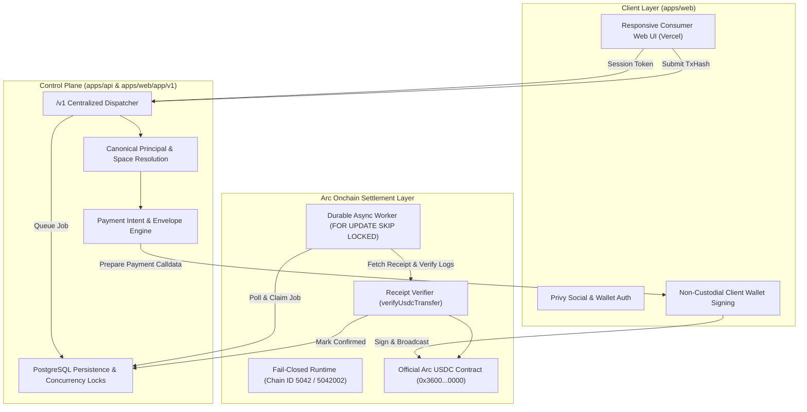

# Microcosm v0.1: Arc Microgrants Final Submission Pack & Release Handoff

> **Submission Deadline:** 14 October 2026 at 23:59 ET (15 October 2026 at 04:59 WAT)  
> **Official Program Route:** [Arc Microgrants on DoraHacks](https://dorahacks.io/hackathon/arc-microgrants) | [Arc Community Event](https://community.arc.io/public/events/arc-microgrants-f8tijfjhyq)  
> **Submission Status:** Draft Ready For Submission  

---

## 1. Executive Summary & Core Deliverables

**Microcosm** is an Arc-native programmable payments and multi-tenant financial coordination protocol. It introduces **Spaces**—isolated financial operating environments for individuals, organizations, and autonomous AI agents—that decouple transaction intent authorization from cryptographic onchain execution.

| Resource | Verified Target | Status |
| :--- | :--- | :--- |
| **Public GitHub Repository** | [`https://github.com/Jaydearcadian/Microcosm`](https://github.com/Jaydearcadian/Microcosm) | **VERIFIED REMOTE** (Commit `6d32fac` public) |
| **Production Consumer Web UI** | [`https://microcosmonarc.vercel.app`](https://microcosmonarc.vercel.app) | **VERIFIED REMOTE** (HTTP 200, Next.js serverless API & UI) |
| **Arc Mainnet RPC** | `https://rpc.mainnet.arc.io/` (Chain ID `5042`) | **VERIFIED REMOTE** (`eth_chainId` returns `0x13b2`) |
| **Arc Testnet RPC** | `https://rpc.testnet.arc.network` (Chain ID `5042002`) | **VERIFIED REMOTE** (`eth_chainId` returns `0x4cf102`) |
| **Arc Official USDC Contract** | `0x3600000000000000000000000000000000000000` (6 Decimals) | **VERIFIED ONCHAIN** (Decimals `6`, Symbol `USDC`) |
| **Live Arc Settlement Proof** | [`0xb9ff68b720ccc128a8791435979dd08b50ea16d189df212a0e4a256b321be408`](https://testnet.arcscan.app/tx/0xb9ff68b720ccc128a8791435979dd08b50ea16d189df212a0e4a256b321be408) | **LIVE WRITE PASS (Testnet)** (Mined in Block `67174208`) |

---

## 2. Release Gate Verification Ledger (G0–G5)

| Gate | Focus Area | Status | Evidence & Verification Commands |
| :---: | :--- | :---: | :--- |
| **G0** | **Baseline & Code Quality** | **LOCAL_PASS** | Clean monorepo dependencies, zero-error typechecking (`npm run typecheck`), 134/134 monorepo tests and 14/14 web gateway tests passing (`npm test`, `npm test --workspace=@mcosm/web`), PostgreSQL concurrency & persistence tests verified. |
| **G1** | **Identity & Space Isolation** | **LOCAL_PASS** | Centralized `/v1` dispatcher, canonical principal resolution decoupled from email/wallet, multi-tenant Space isolation, viewer role read-only enforcement, single-use EIP-191 cryptographic wallet challenge-response linking. Remediated through independent security code review. |
| **G2** | **Consumer Web UI & Gateway** | **LIVE_READ_PASS (UI) / PROXY FAIL-CLOSED (API)** | Mobile-first and desktop-responsive web application in `apps/web`. Dark-mode financial tokens, pure `BigInt` exact base-unit math (zero float loss), Privy social login & wallet integration, `/money` (send flow), `/receive` (QR deposit address), `/people` (isolated contacts), `/activity` (verifiable receipt feed), `/settings`. Next.js gateway routes (`/health`, `/readiness`, `/v1/*`) proxy to secured backend via `MICROCOSM_API_PROXY`, strictly failing closed with 503 if unconfigured, unreachable, missing expected/observed chain IDs, or reporting any degraded dependency (`postgres`, `arc_rpc`, `privy`). |
| **G3** | **Live Arc Settlement Verification** | **LIVE_WRITE_PASS (Testnet) / PENDING USER WALLET SIGNING (Mainnet)** | Live transfer executed on Arc Testnet (chain `5042002`). Transfer of exact base units verified via `verifyUsdcTransfer` checking ERC-20 `Transfer` topic (`0xddf25...`), verified contract `0x3600...0000`, sender, recipient, and base units. Mined in block `67174208`. Tx: [`0xb9ff68b7...21be408`](https://testnet.arcscan.app/tx/0xb9ff68b720ccc128a8791435979dd08b50ea16d189df212a0e4a256b321be408). Mainnet RPC (`https://rpc.mainnet.arc.io/`, chain `5042`) and official USDC contract (`0x3600...0000`) verified onchain and healthy; consumer transfer route is strictly non-custodial and never holds or uses a server-side signing key, pending interactive user wallet signing approval. |
| **G4** | **Deployment & Release Evidence** | **VERIFIED_REMOTE** | Public HTTPS consumer app and serverless API live on Vercel at `https://microcosmonarc.vercel.app`, GitHub repository public at `https://github.com/Jaydearcadian/Microcosm`. Sensitive environment files excluded from deployment bundle via `.vercelignore`. |
| **G5** | **Submission Pack & DoraHacks Handoff** | **DRAFT READY** | Formatted submission pack complete with project pitch, primitives breakdown, architecture diagrams, and copy-paste application form. Outstanding action: final interactive submission on DoraHacks. |

---

## 3. Live Onchain Settlement Evidence

The live Arc onchain settlement test was executed and verified using `@mcosm/adapter-arc` on Arc Testnet:

```json
{
  "status": "confirmed",
  "chainId": 5042002,
  "rpcUrl": "https://rpc.testnet.arc.network",
  "tokenAddress": "0x3600000000000000000000000000000000000000",
  "blockNumber": "67174208",
  "blockHash": "0xd20feb4f94532480a949b41ab27278eaed555632a7020e78b38fcd38beefb60e",
  "transactionHash": "0xb9ff68b720ccc128a8791435979dd08b50ea16d189df212a0e4a256b321be408",
  "explorerUrl": "https://testnet.arcscan.app/tx/0xb9ff68b720ccc128a8791435979dd08b50ea16d189df212a0e4a256b321be408",
  "observedTransfer": {
    "from": "0xa4d196c26f07bcd68fa76a0f1becd2536c4ae9c2",
    "to": "0xa4d196c26f07bcd68fa76a0f1becd2536c4ae9c2",
    "amountBaseUnits": "1"
  }
}
```

---

## 4. Architecture & Primitives Exposed to Arc Builders



---

## 5. DoraHacks Application Form Copy-Paste Fields

When submitting on [DoraHacks Arc Microgrants](https://dorahacks.io/hackathon/arc-microgrants), copy and paste these pre-formatted fields:

### Project Name
`Microcosm`

### Tagline
`Arc-native programmable payments, multi-tenant Spaces, and intent-bound financial coordination.`

### Project Description / Pitch
```text
Microcosm is a mobile-first financial home built around persistent identity and Spaces. Its v0.1 release uses Arc USDC for wallet-authorized transfers, enforces Space-level access controls, and verifies onchain transaction evidence before marking payments as confirmed.

Key primitives exposed for Arc builders:
1. Fail-Closed Arc Settlement Adapter: Chain ID 5042 / 5042002 verification, zero floating-point currency calculations with strict integer base-units (BigInt), and independent onchain receipt log verification for the official Arc USDC contract (0x3600000000000000000000000000000000000000).
2. Client-Authorized Execution Security: Replaces unsafe server-signed consumer execution with intent-bound client signing, eliminating custodial server key risk on consumer routes.
3. Multi-Tenant Spaces Architecture: Enforces strict data and financial isolation across personal spaces, contacts, envelopes, intents, and verifiable payment receipts.
4. Cryptographic Identity & Wallet Linking: Decouples canonical Microcosm principals from specific login providers, supporting single-use EIP-191 cryptographic wallet linking and non-custodial social login via Privy.

Compared to raw sample scripts, Microcosm provides a complete production-grade foundation: responsive consumer web UI on Vercel, audited REST API contracts, PostgreSQL transactional persistence with durable concurrency controls, and fail-closed receipt verification on Arc.
```

### GitHub Repository URL
`https://github.com/Jaydearcadian/Microcosm`

### Live Demo URL
`https://microcosmonarc.vercel.app`

### Arc Onchain Proof / Transaction Hash
`0xb9ff68b720ccc128a8791435979dd08b50ea16d189df212a0e4a256b321be408` (Arc Testnet, Block `67174208`)  
Explorer URL: `https://testnet.arcscan.app/tx/0xb9ff68b720ccc128a8791435979dd08b50ea16d189df212a0e4a256b321be408`

### Contract / Token Address
Arc Official USDC: `0x3600000000000000000000000000000000000000`

---

## 6. Monorepo Verification Summary

```bash
# Verify typechecking across all packages and workspaces
$ npm run typecheck
Exit code: 0 (0 errors)

# Run full automated test suite (monorepo packages & web gateway)
$ npm test
Exit code: 0 (134/134 monorepo tests passing)
$ npm test --workspace=@mcosm/web
Exit code: 0 (14/14 web gateway & security tests passing)

# Build consumer web application and API handlers
$ npm run build --workspace=@mcosm/web
Exit code: 0 (All routes and API handlers generated)
```
