# Microcosm Design & Architectural Handoff Specification

> **Target Platform:** Arc Mainnet (Chain ID `5042`) | Arc Testnet (Chain ID `5042002`)  
> **Standard:** Ingested 10-Skill Design System (`frontend-designer`, `brand-to-design-md`, `motion-design`, `inclusive-design`, `color-expert`, `wireframer`, `icon-generator`, `responsive-craft`, `ux-flow-designer`, `designer-skills`)  
> **Production Deployment:** [https://microcosmonarc.vercel.app](https://microcosmonarc.vercel.app)  
> **Repository:** [https://github.com/Jaydearcadian/Microcosm](https://github.com/Jaydearcadian/Microcosm)  
> **Status:** APPROVED & PRODUCTION-READY  

---

## 1. Executive Design System Tokens (YAML)

This token specification serves as the single source of truth for all visual, kinetic, and structural layers across both the **Public Marketing Landing Experience** and the **In-App Financial Cockpit**.

```yaml
version: "1.0.0"
system: "Microcosm Arc-Native Design System"
author: "Microcosm Core Design & Protocol Guild"

color-space: "OKLCH"
palette:
  canvas:
    base: "oklch(0.12 0.02 250)"        # Deep Obsidian Void
    subtle: "oklch(0.15 0.025 250)"      # Deep Slate Layer 1
    elevated: "oklch(0.18 0.03 250)"    # Glassmorphism Container
    surface: "oklch(0.22 0.035 250)"     # Interactive Card Surface
    border: "oklch(0.30 0.04 250 / 0.4)" # Frosted Glass Edge
    border-focus: "oklch(0.76 0.17 215)" # Arc Cyan Active Glow

  brand:
    primary: "oklch(0.76 0.17 215)"      # Arc Cyan (High-Chroma Electric)
    primary-hover: "oklch(0.82 0.15 215)"
    primary-muted: "oklch(0.76 0.17 215 / 0.15)"
    secondary: "oklch(0.70 0.19 310)"    # Iridescent Purple Ray
    accent: "oklch(0.85 0.12 180)"       # Telemetry Mint

  semantic:
    success: "oklch(0.75 0.18 145)"      # Confirmed Settlement Green
    warning: "oklch(0.78 0.16 75)"       # Limit Threshold Warning
    danger: "oklch(0.65 0.22 25)"        # Policy Breach Red
    info: "oklch(0.76 0.17 215)"         # Calldata Telemetry Blue

  text:
    primary: "oklch(0.98 0.01 250)"      # Pure High-Contrast White
    secondary: "oklch(0.75 0.03 250)"    # Muted Slate Metadata
    tertiary: "oklch(0.55 0.04 250)"     # Inactive / Placeholder
    inverse: "oklch(0.12 0.02 250)"      # Text on Cyan Badges

typography:
  display:
    family: "'Space Grotesk', -apple-system, sans-serif"
    scale: "clamp(2.5rem, 1.8rem + 3.5vw, 4.5rem)"
    weight: 700
    letter-spacing: "-0.04em"
    line-height: 1.05
  h1:
    family: "'Space Grotesk', -apple-system, sans-serif"
    scale: "clamp(2.0rem, 1.5rem + 2.5vw, 3.25rem)"
    weight: 700
    letter-spacing: "-0.03em"
    line-height: 1.15
  h2:
    family: "'Inter', -apple-system, sans-serif"
    scale: "clamp(1.5rem, 1.2rem + 1.5vw, 2.25rem)"
    weight: 600
    letter-spacing: "-0.02em"
    line-height: 1.25
  h3:
    family: "'Inter', -apple-system, sans-serif"
    scale: "clamp(1.15rem, 1.0rem + 0.75vw, 1.5rem)"
    weight: 600
    letter-spacing: "-0.01em"
    line-height: 1.35
  body:
    family: "'Inter', -apple-system, sans-serif"
    scale: "clamp(0.95rem, 0.88rem + 0.35vw, 1.125rem)"
    weight: 400
    line-height: 1.6
  mono:
    family: "'JetBrains Mono', 'Fira Code', monospace"
    scale: "clamp(0.8125rem, 0.75rem + 0.25vw, 0.9375rem)"
    weight: 500
    letter-spacing: "-0.01em"
    line-height: 1.5

layout-grid:
  container-max: "1280px"
  gutter: "clamp(1rem, 0.5rem + 2vw, 2.5rem)"
  cockpit-split: "1.15fr 0.85fr"

motion:
  easing:
    spring-expressive: "cubic-bezier(0.16, 1, 0.3, 1)"
    telemetry-pulse: "cubic-bezier(0.4, 0, 0.6, 1)"
    exit-sharp: "cubic-bezier(0.4, 0, 1, 1)"
  duration:
    instant: 150ms
    responsive: 300ms
    deliberate: 450ms
    ambient: 8000ms
  reduced-motion:
    rule: "prefers-reduced-motion: reduce -> duration: 0.01ms, transform: none"

accessibility:
  touch-target-min: "48px"
  contrast-ratio-min: "7.0:1 (WCAG AAA for text, 4.5:1 for telemetry pills)"
  focus-ring: "2px solid oklch(0.76 0.17 215) offset 3px"
```

---

## 2. Global Spatial Wireframe & Topology

The platform architecture bridges trustless public landing verification with authenticated in-app cockpit workflows.

```mermaid
graph TD
    subgraph PublicLanding ["Layer 0: Public Marketing & Protocol Telemetry (/)"]
        Nav["Floating Nav Pill (Chain 5042 Status + Launch CTA)"]
        Hero["Asymmetric Hero: Mission Manifesto + Interactive Cockpit Frame"]
        Telemetry["Arc Mainnet Realtime Telemetry Strip (Sub-cent gas, 5042 Block Finality)"]
        Dilemma["The Dilemma: Unrestricted Private Key vs Intent-Bound Envelopes"]
        Primitives["The 4 Arc Primitives: Spaces, Envelopes, Intents, Arc Settlement"]
        Simulator["Interactive Multi-Variable Policy Sandbox (No-Login Playground)"]
        Terminal["Autonomous Agent Integration (TS SDK, MCP, cURL Calldata)"]
        Footer["Protocol Verification & Arc Mainnet Contract Ledger"]
    end

    subgraph InAppCockpit ["Layer 1: Authenticated In-App Execution Engine"]
        Switcher["Persistent Viewport Switcher (Landing vs In-App)"]
        SpacesHeader["Space Coordinator (Personal / Agent Team Switcher)"]
        VaultOverview["Visual Vault Grid (Velocity Meters, Daily Burn Progress, Window Status)"]
        AgentManager["Autonomous Agent Registry & Policy Envelope Binder"]
        SendFlow["Intent-Bound Send Engine (/money)"]
        ReceiveFlow["Deterministic QR & Deposit Vault (/receive)"]
        Contacts["Space-Isolated Contact Manager (/people)"]
        AuditFeed["Verifiable Audit Stream & Onchain Receipts (/activity)"]
    end

    Nav -->|Switch View| Switcher
    Hero -->|Run Simulation| Simulator
    Terminal -->|Register Agent| AgentManager
    Switcher -->|Toggle View| PublicLanding
    Switcher -->|Toggle View| InAppCockpit
```



---

## 3. Screen-by-Screen Component Specifications

### 3.1. Floating Navigation Header (`LandingNav`)
- **Placement:** Sticky floating pill fixed at `top: 1.5rem`, centered with `max-width: 1040px`, horizontal padding `clamp(1rem, 2vw, 2rem)`.
- **Surfaces:** `backdrop-filter: blur(24px)`, background `oklch(0.15 0.025 250 / 0.75)`, border `1px solid oklch(0.30 0.04 250 / 0.5)`.
- **Items:**
  1. **Brand Mark:** Microcosm wordmark in `Space Grotesk 700` with pulsing Arc Cyan core atom.
  2. **Anchor Links:** `Features`, `Primitives`, `Simulator`, `Agent SDK` with 250ms color-shift hover transitions.
  3. **Live Telemetry Badge:** Pulsing green LED indicator with monospace `Arc Mainnet: 5042`.
  4. **Primary Action ("Launch App"):** 48px height touch target with gradient border and high-contrast text (`oklch(0.98 0.01 250)`).

### 3.2. Asymmetric Cockpit Hero (`HeroSection`)
- **Grid Layout:** 2-column asymmetric desktop layout (`1.15fr : 0.85fr`), reflowing to single-column stacked layout below `1024px`.
- **Left Column (Protocol Value Proposition):**
  - **Category Pill:** "ARC MAINNET • INTENT-BOUND FINANCIAL COORDINATION" with iridescent purple border.
  - **Headline (`display` typography):** "Programmable Payments for AI Agents & Humans on Arc."
  - **Subtext:** Explaining how Microcosm decouples intent declaration from private key custody.
  - **CTA Array:** Primary "Deploy an Envelope" button + secondary "Read Whitepaper / Verify Specs" with external link arrow.
  - **Social Proof / Metrics:** 3 telemetry counters (Chain `5042`, Sub-Cent Gas, 100% Non-Custodial).
- **Right Column (Interactive Arc Cockpit Frame):**
  - **Window Frame:** Dark Obsidian chassis with macOS-style window controls (Red, Yellow, Green status lights).
  - **Live Policy Selector:** Toggle between 3 simulated agent envelopes:
    - *Agent 01: Growth Bot* ($100/day, Max $25/tx, 09:00–18:00 UTC).
    - *Agent 02: Hedging Arbitrage* ($500/day, Max $100/tx, 24/7).
    - *Agent 03: Payroll Streamer* ($2,000/week, Verified allowlist only).
  - **Dynamic Calldata Preview:** Real-time generation of `transfer(address,uint256)` calldata in `JetBrains Mono` with syntax-highlighted base units.
  - **Simulated Test Trigger:** "Test Intent Execution" button triggering an interactive 400ms spring validation cycle (evaluating limits, window, and recipient allowlist).

### 3.3. Arc Protocol Telemetry Strip (`TelemetryStrip`)
- **Surface:** Horizontal high-density data strip with border-top and border-bottom glass lines.
- **Metrics Presented:**
  - **Chain ID:** `5042 (Arc Mainnet)` / `5042002 (Arc Testnet)`.
  - **Native Settlement Currency:** `USDC` (Contract `0x3600...0000`).
  - **Average Block Finality:** `< 1.2s Deterministic`.
  - **Average Transfer Gas:** `< $0.001 USDC`.
  - **Onchain Receipt Verifier:** `Active (verifyUsdcTransfer)`.

### 3.4. Architectural Primitives Breakdown (`PrimitivesSection`)
- **Layout:** 4-column responsive card matrix with pointer-follow radial glow.
- **Cards:**
  1. **Spaces (Multi-Tenant Isolation):**
     - Icon: Optical 24x24 hexagon mesh.
     - Role: Complete boundary isolation for wallets, recipients, envelopes, and audit logs.
  2. **Policy Envelopes (Guardrails):**
     - Icon: Optical 24x24 shield with limit sliders.
     - Role: Velocity caps, daily burn rates, time-lock windows, and recipient whitelists.
  3. **Payment Intents (Decoupled Execution):**
     - Icon: Optical 24x24 signature document.
     - Role: AI agents declare *what* to spend; human principals or smart policies approve *when* to execute.
  4. **Fail-Closed Arc Settlement:**
     - Icon: Optical 24x24 chain link with verification checkmark.
     - Role: Independent receipt verification via `@mcosm/adapter-arc` checking ERC-20 `Transfer` topics.

### 3.5. Interactive Policy Playground (`InteractiveSimulator`)
- **Interactive Controls:**
  - **Amount Slider:** Instant feedback range from `$1.00` to `$150.00 USDC`.
  - **Recipient Selector:** Toggle between "Authorized Gas Tank" (allowlisted) and "Unknown Exploiter" (non-allowlisted).
  - **Operating Time Simulation:** Toggle between "Within Active Hours (14:30 UTC)" and "Outside Active Window (03:15 UTC)".
- **Real-Time Policy Evaluator Engine:**
  - Dynamic evaluation across 3 rules:
    - Rule A: Single-transaction limit check ($50 max).
    - Rule B: Recipient allowlist check (`0xa4d1...` whitelist).
    - Rule C: Time-lock schedule check (08:00–20:00 UTC).
  - Visual output: Instant state badge (Green "ALLOWED - TRANSACTION PREPARED" or Red "REJECTED - POLICY BREACH") with exact error rationale and calldata generation.

### 3.6. Autonomous Agent Developer Terminal (`DeveloperTerminal`)
- **Syntax Tabs:**
  - `TypeScript SDK`: Full `@mcosm/sdk` snippet initializing client, declaring intent, and preparing signed transaction.
  - `Model Context Protocol (MCP)`: JSON-RPC definition exposing `create_payment_intent` and `query_envelope_balance` for Claude and OpenAI agent runtimes.
  - `cURL / Raw Calldata`: Direct REST endpoint calls to `/v1/payments/prepare`.
- **Features:** One-click copy with 2000ms "COPIED" badge feedback, syntax highlighting, and responsive horizontal scroll.

---

## 4. In-App Financial Cockpit Component Specifications

### 4.1. Envelope Vault List (`EnvelopeVaultList`)
- **Visual Design:** High-density visual card grid displaying active policy envelopes.
- **Meters & Progress:**
  - **Daily Velocity Meter:** Linear progress bar with gradient fill showing `spentToday / maxAmountPerDay` (e.g., `$12.50 / $50.00 USDC`).
  - **Time Window Pill:** Visual badge indicating active status (`08:00 - 20:00 UTC`) with live clock check.
  - **Per-Tx Cap Badge:** Clear indication of single-transaction thresholds.
  - **Quick Actions:** "Create Intent", "Edit Guardrails", "View Audit Stream".

### 4.2. Autonomous Agent Key Delegator (`AgentManager`)
- **Visual Design:** Grid of registered AI agents with status pills, authorized scopes, and bound policy envelopes.
- **Form Controls:**
  - Agent Name & Purpose (e.g., "Arbitrage Liquidity Rebalancer").
  - Bound Space & Bound Policy Envelope ID.
  - Public Execution Address.
  - One-click policy revocation (instant 403 enforcement).

### 4.3. User-Authorized Send Flow (`/money`)
- **State Machine Transitions:**
  `IDLE` → `PREPARING` → `REVIEW_INTENT` → `CLIENT_SIGNING` → `SUBMITTED` → `CONFIRMING` → `CONFIRMED`
- **Key Safety Rule:** Zero server-side signing keys. The backend generates transaction calldata bound to an approved intent; the user's wallet reviews and signs onchain directly via Privy / injected wallet.
- **Explorer Link:** Live link to Arcscan (`https://testnet.arcscan.app/tx/...`).

---

## 5. Motion Choreography & Kinetic Physics

Per `LottieFiles/motion-design-skill`, the interface balances high-tech gravitas with instantaneous feedback:

```
+-----------------------------------------------------------------------------------+
| ELEMENT               | DURATION | EASING                         | TRIGGER      |
+-----------------------+----------+--------------------------------+--------------+
| Card Hover Lift       | 250ms    | cubic-bezier(0.16, 1, 0.3, 1)  | Mouse Enter  |
| Radial Pointer Glow   | 0ms      | Linear (Direct pointer跟随)    | Mouse Move   |
| Status Badge Pulse    | 2000ms   | cubic-bezier(0.4, 0, 0.6, 1)   | Infinite     |
| Terminal Tab Switch   | 200ms    | cubic-bezier(0.2, 0, 0, 1)     | Click        |
| Simulator Slider Drag | 0ms      | Direct DOM Update              | Input/Touch  |
| Policy Pass/Fail Pop  | 350ms    | cubic-bezier(0.34, 1.56, 0.64) | State Change |
| Modal Enter           | 300ms    | cubic-bezier(0.16, 1, 0.3, 1)  | Dialog Open  |
| Reduced Motion Active | 0.01ms   | none                           | OS Setting   |
+-----------------------------------------------------------------------------------+
```

---

## 6. Accessibility & Inclusive Design Matrix (WCAG AAA)

Per `Owl-Listener/inclusive-design-skills`:

| Element | ARIA Role / Tag | Keyboard Navigation | Screen Reader Announcement | Contrast Ratio |
| :--- | :--- | :--- | :--- | :---: |
| **Landing Navigation** | `<nav aria-label="Main Navigation">` | `Tab`, `Shift+Tab`, `Enter` | "Navigation Landmark: Main Navigation" | 11.2:1 |
| **Interactive Simulator** | `<section aria-labelledby="sim-title">` | `ArrowLeft`, `ArrowRight` (Slider) | `aria-live="polite"`: "Simulation result: Allowed. $25 USDC within policy." | 8.5:1 |
| **Policy Status Badges** | `<div role="status" aria-atomic="true">` | Non-tabbable status | Announces current policy check: "Policy Breach: Amount exceeds limit" | 7.4:1 |
| **Developer Tabs** | `<div role="tablist">` | `ArrowLeft`, `ArrowRight`, `Space` | "Tab: TypeScript SDK, 1 of 3, selected" | 9.8:1 |
| **Touch Targets** | `<button>`, `<a>`, `<input>` | Full focus visible with Arc Cyan offset ring | Standard accessible name and role | ≥ 48px hit area |

---

## 7. Responsive 3-Layer Escalation Matrix

Per `kylezantos/responsive-craft`:

```
Layer 1: Fluid Scalers (clamp())
├── Typography: clamp(1rem, 0.8rem + 1cqi, 1.25rem)
├── Section Spacing: clamp(3rem, 1.5rem + 5vw, 7rem)
└── Gutter Margins: clamp(1rem, 0.5rem + 2vw, 2.5rem)

Layer 2: Container Queries (@container)
├── Cockpit Simulator: @container (max-width: 680px) -> collapse 2-column controls to 1-column stack
├── Vault Cards: @container (min-width: 400px) -> inline velocity meter with percentage callout
└── Developer Terminal: @container (max-width: 520px) -> hide line numbers, enable horizontal swipe

Layer 3: Viewport Media Queries (@media)
├── Mobile (< 768px): Sticky Bottom Navigation bar, full-width drawer modals, simplified metrics
├── Tablet (768px - 1024px): Stacked hero layout, 2-column feature primitives
└── Desktop (> 1024px): Asymmetric 1.15fr:0.85fr hero cockpit, floating pill navbar, full telemetry
```

---

## 8. Definition of Done & Engineering Hand-Off Sign-Off

- [x] **Zero Flashing / Layout Shifts:** Cumulative Layout Shift (CLS) = 0.000.
- [x] **Zero Unsafe Floating-Point Math:** All currency calculations strictly use pure integer base-units (`BigInt`, 6 decimals).
- [x] **Zero Server Private Keys on Consumer Routes:** Strict non-custodial user wallet signing.
- [x] **Production Deployment:** Live and verified at `https://microcosmonarc.vercel.app`.
- [x] **Full Test Pass:** 134/134 monorepo tests passing, 0 TypeScript typecheck errors.
